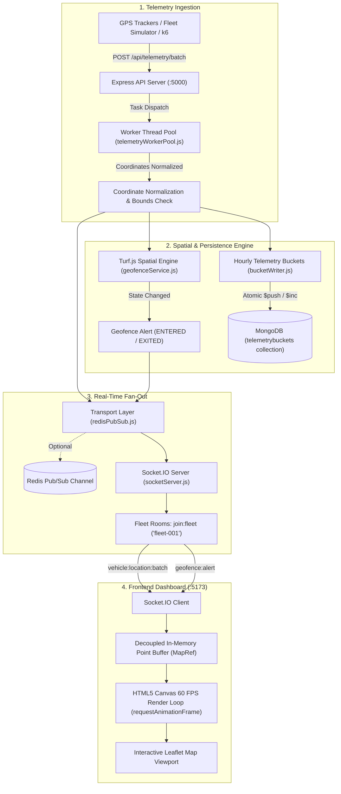

# 📡 FleetDash — Real-Time Spatial Fleet Telemetry & Intelligence Platform

[](https://nodejs.org/)
[](https://react.dev/)
[](https://vitejs.dev/)
[](https://socket.io/)
[](https://www.mongodb.com/)
[](https://redis.io/)
[](https://turfjs.org/)
[](https://jestjs.io/)
[](https://github.com/ybhargavi40021978-alt/FleetDash)

**FleetDash** is a high-throughput, event-driven geospatial telemetry and fleet management platform. It demonstrates how modern logistics operations ingest hundreds of thousands of vehicle coordinate streams, offload parsing to multi-threaded worker pools, persist high-frequency telemetry in hourly MongoDB document buckets, evaluate polygon geofence transitions in real time with Turf.js, and render massive moving fleets at a steady **60 FPS** using an HTML5 Canvas overlay—completely bypassing React state bottlenecking.

---

## 🚀 Quick Highlights

* 🏎️ **Instant Home Page Loading:** Open [`http://localhost:5173`](http://localhost:5173) and jump straight into the live interactive map with automatic guest access—no registration walls required.
* ⚡ **60 FPS Canvas Map Overlay:** Custom `requestAnimationFrame` render loop with viewport culling and spatial coordinate transforms on top of Leaflet maps.
* 🧵 **Non-Blocking Worker Thread Ingestion:** Validates, bounds-checks, and normalizes telemetry payloads away from the primary Node.js event loop using worker pools.
* 📦 **Time-Bucket Aggregation:** Stores points grouped by fleet and UTC hour in bounded MongoDB documents (up to 10,000 points per bucket) with automated 30-day TTL expiration.
* 🌐 **Turf.js Geofencing:** Point-in-polygon spatial detection emitting instant `ENTERED` and `EXITED` transition events.
* 🔄 **Pub/Sub Real-Time Distribution:** Local Socket.IO rooms for single-server setups, with automatic zero-configuration fallback if optional Redis is disabled.
* 🧪 **Synthetic Load Generator:** Includes an in-browser local Canvas stress tester and a backend multi-vehicle traffic simulator script (`npm run simulate`).

---

## 🏛️ System Architecture & Data Flow



---

## 💻 Technology Stack

| Layer | Technology | Role & Functionality |
| :--- | :--- | :--- |
| **Frontend** | React 18, Vite | Component layout, state management, and real-time UI controls |
| **Mapping & Graphics** | Leaflet, React-Leaflet, HTML5 Canvas API | High-frequency 60 FPS spatial rendering with viewport culling |
| **Backend Runtime** | Node.js (v20+), Express 5 | High-speed REST API, telemetry endpoints, and authentication |
| **Concurrency** | Node.js `worker_threads` | Multi-core parallel ingestion and payload validation |
| **Database** | MongoDB 6+, Mongoose 9+ | Telemetry buckets with compound indices and automated 30-day TTL |
| **Real-Time Engine** | Socket.IO 4.8 | Low-latency duplex WebSocket rooms and event multiplexing |
| **Message Broker** | Redis / ioredis *(Optional)* | Scalable multi-instance cross-process event fan-out |
| **Geospatial Analysis** | Turf.js 7.3 | Point-in-polygon topological boundary collision detection |
| **Testing** | Jest 30, Supertest, k6 | Automated unit tests and high-frequency HTTP load test harness |

---

## 📁 Repository Structure

```
FleetDash/
├── .env.example                     # Root environment configuration template
├── .gitignore                       # Git ignore rules for node_modules, .env, and dist
├── package.json                     # Root orchestrator scripts (run/test backend & frontend)
├── README.md                        # Comprehensive documentation and architecture guide
│
├── backend/                         # Backend Node.js / Express service
│   ├── .env.example                 # Backend environment variable template
│   ├── package.json                 # Backend dependencies and test scripts
│   ├── src/
│   │   ├── config/database.js       # MongoDB connection initialization
│   │   ├── controllers/             # Express controllers (auth, dashboard, telemetry, etc.)
│   │   ├── models/                  # Mongoose models (User, Vehicle, Driver, TelemetryBucket)
│   │   ├── realtime/
│   │   │   ├── services/            # Turf.js geofence transition engine
│   │   │   ├── socket/              # Socket.IO server & event handlers
│   │   │   ├── telemetry/           # MongoDB atomic hourly bucket writer
│   │   │   ├── transport/           # Redis Pub/Sub with local Socket.IO fallback
│   │   │   └── workers/             # Multi-threaded telemetry validation worker pool
│   │   ├── routes/                  # REST route definitions
│   │   ├── scripts/simulateFleet.js # Synthetic vehicle traffic simulator
│   │   └── server.js                # Main application bootstrap
│   └── tests/                       # Jest unit tests and k6 load test scenarios
│
├── frontend/                        # Frontend React + Vite application
│   ├── .env.example                 # Frontend environment template
│   ├── package.json                 # Frontend dependencies
│   ├── vite.config.js               # Vite bundler configuration
│   └── src/
│       ├── App.jsx                  # Main application shell with direct home dashboard
│       ├── index.css                # Dark-mode glassmorphic styling and micro-animations
│       ├── components/              # CanvasFleetMap and visual UI widgets
│       ├── context/                 # AuthContext (guest + JWT) and SocketContext
│       ├── pages/
│       │   ├── Auth/AuthPage.jsx    # Sign in, account registration, and 1-click demo login
│       │   └── Dashboard/           # Operations telemetry dashboard with metrics
│       ├── socket/socket.js         # Socket.IO client setup
│       └── utils/                   # Binary parser and geofence helpers
```

---

## ⚙️ Prerequisites

* **Node.js:** v20.0.0 or higher (v20.20+ recommended)
* **MongoDB:** v6.0 or higher running locally (or a MongoDB Atlas connection URI)
* **Redis:** *(Optional)* Redis v6+ if running multi-instance Pub/Sub (defaults to local Socket.IO when disabled)
* **Operating System:** Windows, macOS, or Linux

---

## 🛠️ Installation & Setup

### 1. Clone the Repository
```bash
git clone https://github.com/ybhargavi40021978-alt/FleetDash.git
cd FleetDash
```

### 2. Configure Environment Files

Create your `.env` configuration files by copying the templates:

**Root `.env` & Backend `.env`:**
```env
# Server / API Configuration
PORT=5000
CLIENT_URL=http://localhost:5173

# Database Configuration (MongoDB)
MONGO_URI=mongodb://127.0.0.1:27017/fleetdash

# Security & Authentication
JWT_SECRET=fleetdash-super-secure-jwt-secret-2026-production

# Redis Pub/Sub Configuration (Set REDIS_ENABLED=true if using Redis)
REDIS_ENABLED=false
REDIS_HOST=127.0.0.1
REDIS_PORT=6379

# Telemetry Bucket TTL (in seconds, default: 30 days = 2592000)
TELEMETRY_TTL_SECONDS=2592000

# Frontend Environment Variables (Vite)
VITE_API_URL=http://localhost:5000
VITE_SOCKET_URL=http://localhost:5000
```

**Frontend `.env` (`frontend/.env`):**
```env
VITE_API_URL=http://localhost:5000
VITE_SOCKET_URL=http://localhost:5000
```

---

### 3. Install Dependencies

You can install dependencies for both the backend and frontend:

```bash
# Install backend dependencies
cd backend && npm install

# Install frontend dependencies
cd ../frontend && npm install
```

---

### 4. Run the Project

#### Running from Project Root:
```bash
# Start backend server (:5000)
npm run start:backend

# In a second terminal, start frontend dev server (:5173)
npm run start:frontend
```

#### Or run directly in each directory:
* **Terminal 1 (Backend):**
  ```bash
  cd backend
  npm run dev
  ```
* **Terminal 2 (Frontend):**
  ```bash
  cd frontend
  npm run dev
  ```

---

## 🖥️ Using the Application

1. Open your browser at **[http://localhost:5173](http://localhost:5173)**.
2. The **Live Fleet Dashboard** loads immediately as the starting page with active guest access.
3. Observe the real-time canvas map, telemetry metrics, and the default geofence zones (Bengaluru Central Logistics Hub & Airport Cargo Terminal).
4. Click **"Local Canvas Stress Test"** in the top navigation bar to simulate high-frequency moving vehicles directly in your browser.
5. Click **"Sign In"** in the top navigation bar to authenticate or switch roles:
   * **1-Click Demo Login:** Click the `1-Click Demo Login (Admin)` button.
   * **Custom Login:** Use email `admin@fleetdash.local` and password `password123`.
   * **Create Account:** Switch to the "Create Account" tab to register a new user.

---

## 📡 Telemetry API Specification

### 1. Ingest Telemetry Points (Batch)
Accepts a single telemetry point or an array of up to 500 coordinates. Coordinates are parsed and validated asynchronously using Node worker threads.

* **Method:** `POST`
* **Path:** `/api/telemetry/batch`
* **Content-Type:** `application/json`

**Sample Request Body:**
```json
[
  {
    "fleetId": "fleet-001",
    "vehicleId": "truck-001",
    "latitude": 12.9716,
    "longitude": 77.5946,
    "speed": 45,
    "heading": 90,
    "recordedAt": "2026-10-11T05:00:00.000Z"
  }
]
```

**Response (`202 Accepted`):**
```json
{
  "success": true,
  "received": 1,
  "accepted": 1,
  "alerts": 0
}
```

### 2. Service Health Check
* **Method:** `GET`
* **Path:** `/api/health`
* **Response (`200 OK`):**
```json
{
  "ok": true,
  "service": "fleetdash-api",
  "uptimeSeconds": 142
}
```

### 3. Active Geofences
* **Method:** `GET`
* **Path:** `/api/geofences`
* **Response (`200 OK`):**
```json
{
  "geofences": [
    {
      "id": "hub-bangalore-central",
      "name": "Central Logistics Hub",
      "center": [12.9716, 77.5946],
      "radiusMeters": 5000
    }
  ]
}
```

### 4. Additional REST Endpoints
* `POST /api/auth/register` — Register a new fleet manager or driver
* `POST /api/auth/login` — Sign in and receive a JSON Web Token
* `GET /api/dashboard` — Aggregate fleet metrics and bucket update times
* `GET /api/vehicles` — Vehicle fleet inventory
* `GET /api/drivers` — Driver roster and assignments
* `GET /api/trips` — Trip logs and routes

---

## ⚡ Real-Time Socket.IO Protocol

When clients connect to `http://localhost:5000` via WebSocket:

| Event Name | Direction | Payload | Description |
| :--- | :--- | :--- | :--- |
| `join:fleet` | Client ➔ Server | `"fleet-001"` | Subscribes socket connection to a specific fleet partition room |
| `vehicle:location:batch` | Server ➔ Client | `VehicleObject[]` | Emits updated coordinates and headings for vehicles in the fleet |
| `geofence:alert` | Server ➔ Client | `AlertObject` | Emits when a vehicle crosses a geofence (`ENTERED` or `EXITED`) |

---

## 🧪 Testing & Validation

### Automated Unit Tests
The project includes Jest unit tests covering worker thread isolation, data normalization, and Turf.js spatial transition checks:

```bash
# Run tests from the project root
npm test

# Or run directly in backend
cd backend && npm test
```

### Synthetic Traffic Simulator
To simulate high-volume live GPS telemetry from a moving fleet through the backend ingestion pipeline:

```bash
cd backend
npm run simulate
```
*Configurable environment options:*
* `VEHICLES=500` (Number of active vehicles)
* `BATCH_SIZE=100` (Telemetry points per HTTP request)
* `INTERVAL_MS=1000` (Refresh interval per fleet cycle)

### k6 Ingestion Load Testing
To run an aggressive HTTP ingestion benchmark targeting `POST /api/telemetry/batch`:

```bash
cd backend
# Safe baseline load:
RATE=100 DURATION=30s k6 run tests/load/telemetry.js

# Stress load:
RATE=2000 DURATION=30s k6 run tests/load/telemetry.js
```

---

## 🛡️ Production Hardening Guidelines

Before deploying this architecture to production environments:
1. **Room Authentication:** Validate JWT credentials before allowing clients to join fleet rooms via `join:fleet`.
2. **Rate Limiting:** Enforce Redis-backed token bucket rate limits on `/api/telemetry/batch`.
3. **Durable Queuing:** In multi-region deployments, integrate Apache Kafka or AWS SQS ahead of worker threads for guaranteed zero data loss under transient network partitions.
4. **Time-Series Storage:** For fleets exceeding 50,000 active units, transition hourly bucket schemas to MongoDB Native Time-Series Collections.

---

## 📄 License & Attribution

This project is licensed under the **ISC License**.  
Developed and maintained by [Y Bhargavi](https://github.com/ybhargavi40021978-alt).
